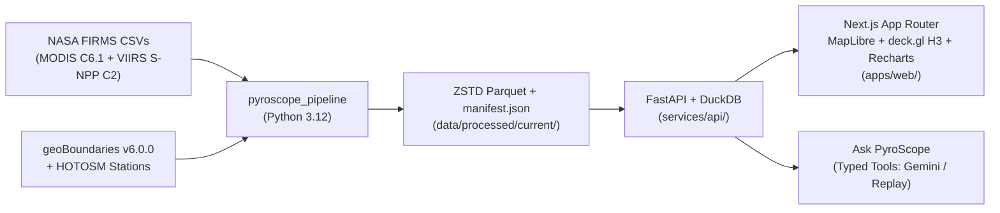
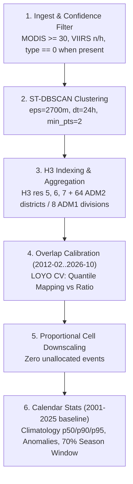

# PyroScope: Burning Activity Calendar

> **NASA Space Apps Challenge 2026** — *Harmonization of MODIS and VIIRS Hot Spots*  
> **Team:** Perceptron  
> **Repository:** https://github.com/azmaeenmahtab/Nasa-Space-App-Harmonization-Perceptron  
> **Demo Video (240s):** https://youtu.be/O7Fo4-lNndQ?si=PZ3GMXMkyO8Hx_7Q  
> **Live Demo:** *Deployment URL pending (Render + Vercel; see [Production Deployment](#production-deployment--data-shipping))*

PyroScope harmonizes NASA MODIS (1 km, 2000–present) and VIIRS S-NPP (375 m, 2012–present) active-fire records into one consistent 2000–present **Burning Activity Calendar** (`FireCalendar`) for early warning, wildland management, scientists, and emergency response across Bangladesh and the Chittagong Hill Tracts (CHT).

---

## The Problem & Measured Impact

MODIS and VIIRS detect active fires at different spatial resolutions (1 km vs. 375 m). In Bangladesh (2012–2025 complete overlap), annual raw MODIS averages **9,645** detections/yr while raw VIIRS S-NPP averages **39,193** detections/yr (**4.10x** raw ratio; **3.77x** after science filtering). Naively splicing MODIS (pre-2012) to VIIRS (2012+) creates an artificial **"hidden jump"** in 2012 (**1.85x** post-splice/pre-splice jump in event counts).

PyroScope resolves this in two stages:
1. **Space-Time DBSCAN Event Clustering (`2,700 m`, `24 h`, `min_pts = 2`):** Condenses pixel hot spots into discrete physical fire events, shrinking the annual VIIRS/MODIS gap from ~3.8x–4.1x pixels down to **~1.5x** events (~560 MODIS vs. ~860 VIIRS events/yr).
2. **Regional Quantile Mapping / Ratio Calibration:** Calibrates VIIRS events to MODIS-equivalent units per district (or parent division fallback when mean monthly MODIS < 3) using Leave-One-Year-Out cross-validation over the **177 complete overlap months** (`2012-02` to `2026-10`), then proportionally downscales to H3 cells with **0.0 unallocated events**.

| Metric | Naive Splice | PyroScope Harmonized | Source |
| --- | :---: | :---: | --- |
| Pre-Splice Baseline (2007–2011 mean events/yr) | `665.2` | `665.2` | `data/processed/current/diagnostics.json` |
| Post-Splice Mean (2012–2016 mean events/yr) | `1,230.2` | `572.9` | `data/processed/current/diagnostics.json` |
| Post/Pre-Splice Jump Ratio | **`1.85x` (+85%)** | **`0.86x` (-14%)** | `data/processed/current/diagnostics.json` |
| National Overlap LOYO CV RMSE / Bias | — | `792.14` / `+334.37` events/mo | `data/processed/current/diagnostics.json` |
| Unallocated Harmonized Events | — | **`0.0`** | `data/processed/current/manifest.json` |

---

## Screenshots

> *Live deployment screenshots can be placed in `docs/screenshots/` once Render/Vercel hosting is finalized.*

- **Main Map & FireCalendar (`/?demo=1`)** — 3D H3 hexagon heatmap (`res 5/6/7`), CHT preset & district selection, and 2000–present anomaly calendar.
- **Hidden Jump Comparison (`/hidden-jump`)** — Raw MODIS vs. Raw VIIRS vs. Naive Splice vs. Harmonized time series.
- **Ask PyroScope (`/ask`)** — Tool-grounded Q&A with deterministic citations and labeled `replay` mode.
- **Methodology & Transparency (`/methodology`)** — Calibration summary, Q-Q plot, parameters, and limitations.

---

## Architecture & Pipeline Diagrams

### System Architecture



### Harmonization Pipeline (`pipeline/`)



### Monorepo Layout

```text
apps/web/                         Next.js App Router (TypeScript, Tailwind, MapLibre, deck.gl H3)
services/api/                     FastAPI + DuckDB (reads ZSTD Parquet tables, SQLite alerts state)
pipeline/                         pyroscope_pipeline (ingest, ST-DBSCAN, aggregate, harmonize, stats, nrt)
contracts/openapi.yaml            OpenAPI 3.1 contract
data/                             Parquet storage (raw, interim, processed, reference, fixtures)
scripts/                          Deployment smoke tests (smoke.sh, smoke.ps1)
render.yaml                       Render Blueprint for API + Web Docker services
```

---

## Data Lineage & Pipeline Parameters

Active committed dataset version: **`v2026-10-31-f4296770`** (`as_of_date: 2026-10-31`, `data/processed/current/manifest.json`):

- **Sources:**
  - `fire_archive_M-C61_842592.csv` (`MODIS_C6.1_Archive`, `264,682` rows, `2000-11-02` to `2026-08-28`)
  - `fire_archive_SV-C2_842593.csv` (`VIIRS_SNPP_C2_Archive`, `572,044` rows, `2012-01-20` to `2026-07-28`)
  - `fire_nrt_M-C61_842592.csv` (`MODIS_C6.1_NRT`, `30` rows, `2026-09-02` to `2026-11-01`)
  - `fire_nrt_SV-C2_842593.csv` (`VIIRS_SNPP_C2_NRT`, `412` rows, `2026-08-02` to `2026-11-01`)
- **Processing Counts:** `837,168` raw detections → `59,644` dropped by confidence/type, `1` duplicate dropped → `758,730` kept detections → `109,246` fire events (`139,544` isolated noise points dropped; `78,672` bbox-edge events outside Bangladesh polygons).
- **Default Parameters (`pipeline/config.yaml`):**
  - Bounding box: `[88.0, 20.5, 92.8, 26.7]`
  - Confidence/type filters: `MODIS >= 30`, `VIIRS in {"n", "h"}`, `type == 0` when column exists (NRT files omit `type`)
  - ST-DBSCAN: `eps_spatial_meters = 2700.0`, `eps_temporal_hours = 24.0`, `min_pts = 2`
  - H3 resolutions: `[5, 6, 7]`
  - Calibration fallback: `min_mean_monthly_modis = 3`, `month_pool_width = 1`, `cv_method = leave_one_year_out`, `methods = ["quantile_map", "ratio"]`
  - Calendar baselines: complete years `2001–2025`, percentiles `[50, 90, 95]`, `season_share_threshold = 0.7`

---

## Running Locally & Offline Judging (Docker)

### Option 1: Docker Compose (Zero Local Toolchain Required)

```bash
docker compose up --build
```

- **Web Application:** http://localhost:3000
- **Interactive Pitch Guide:** http://localhost:3000/?demo=1 (CHT preset + 4-step walkthrough)
- **API Docs (Swagger):** http://localhost:8000/docs
- **Offline Assistant:** `LLM_PROVIDER=replay` is enabled by default (requires no external API keys).

Run automated smoke verification against the API:

```bash
# Linux / macOS
./scripts/smoke.sh http://localhost:8000

# Windows PowerShell
.\scripts\smoke.ps1 -ApiUrl http://localhost:8000
```

### Option 2: Local Development (`uv` + `pnpm` + `make`)

**Prerequisites:** Python 3.12+, [`uv`](https://docs.astral.sh/uv/), Node.js 22 LTS, `pnpm` 12+, `make`.

```bash
# 1. Install Python workspace + web dependencies
make setup

# 2. (Optional) Re-run data pipeline from raw CSVs in data/raw/
make pipeline

# 3. Start backend and frontend in separate terminals
make dev-api     # FastAPI on http://localhost:8000
make dev-web     # Next.js on http://localhost:3000
```

### Lint & Test Suite

```bash
make lint        # ruff, mypy (pipeline + services/api), next typecheck + eslint
make test        # pytest + vitest
```

---

## Production Deployment & Data Shipping

### 1. Blueprint Deployment (Render)
The root [render.yaml](render.yaml) defines both `pyroscope-api` (`services/api/Dockerfile`, `DATA_DIR=/workspace/data/processed/current`, `LLM_PROVIDER=replay`) and `pyroscope-web` (`apps/web/Dockerfile`). After deploying, set `WEB_ORIGIN` on `pyroscope-api` to the live `pyroscope-web` HTTPS URL.

### 2. Split Deployment (Vercel Web + Render/Fly/Cloud Run API)
- **Web (`apps/web`):** Root directory `apps/web`, build command `pnpm build`, output `.next`. Set `NEXT_PUBLIC_API_URL` (HTTPS URL of API) and `NEXT_PUBLIC_BASEMAP_STYLE_URL=https://basemaps.cartocdn.com/gl/dark-matter-gl-style/style.json`.
- **API (`services/api/Dockerfile`):** Build context `.` (repo root). Set `DATA_DIR=/workspace/data/processed/current`, `REFERENCE_DIR=/workspace/data/reference`, `WEB_ORIGIN=<frontend-url>`, `LLM_PROVIDER=replay` (or `gemini` with `GEMINI_API_KEY`).

### 3. Data Rollback Procedure
1. Retain the previous processed version directory (e.g., `data/processed/v2026-10-31-f4296770/`).
2. Point `DATA_DIR` on the API host to the previous directory and restart the service (`services/api` validates `manifest.json` on startup).
3. Verify with `./scripts/smoke.sh <PROD_URL>`.

---

## Scientific Limitations

- Active-fire counts are not burned area. Harmonized counts are "MODIS-equivalent fire events", not hectares.
- The calibration assumes the MODIS–VIIRS relationship observed in 2012–present also holds before 2012 (it cannot be tested there).
- MODIS is itself not homogeneous: Aqua joined Terra in mid-2002, and Terra/Aqua orbits have drifted. We report this explicitly in the methodology diagnostics.
- Cloud, smoke, and underground fires are under-detected by both sensors.
- Harmonization quality is measured by agreement over the overlap period (leave-one-year-out CV), not by the absence of change; real trends can remain.
- Alerts and guidance are advisory, not an official warning system.

---

## Data Sources, Attribution & Licenses

- **Software License:** [MIT License](LICENSE)
- **Active Fire Data:** We acknowledge the use of data and/or imagery from NASA's Fire Information for Resource Management System (FIRMS) (https://firms.modaps.eosdis.nasa.gov), part of NASA's Earth Observing System Data and Information System (EOSDIS) — MODIS Collection 6.1 (`MCD14DL`) and VIIRS S-NPP Collection 2 (`VNP14IMGTDL`).
- **Administrative Boundaries:** Administrative boundaries courtesy of **geoBoundaries** v6.0.0 (Runfola et al., 2020, *PLOS ONE* 15(4): e0231866), **Bangladesh Bureau of Statistics (BBS)**, and **UN OCHA ROAP** (licensed under CC BY 3.0 IGO / CC0 1.0).
- **Fire Service Stations:** Humanitarian OpenStreetMap Team (HOTOSM) / OpenStreetMap Bangladesh Points of Interest via HDX (ODbL 1.0); Bangladesh Fire Service & Civil Defence emergency numbers (`102` / `999`).
- **Basemap:** CARTO Dark Matter GL / MapLibre / OpenStreetMap contributors (ODbL / CC BY 4.0).

---

## Team Perceptron

| Name / Handle | Role |
| --- | --- |
| **Shirsha (`@Aragon`)** | Team Leader & Developer |
| **`@azmaeenmahtab`** | Member & Developer |
| **`@adityasaha03`** | Member & Developer |
| **`@anamraiyan`** | Member & Developer |
| **`@Rohan`** | Member & Developer |

---

## AI Tools Disclosure

In accordance with NASA Space Apps Challenge 2026 disclosure guidelines:
- **AI Tools Used During Development:** Antigravity, Claude Code, Cursor, and the Gemini API.
- **Verification & Scientific Integrity:** All data ingestion, ST-DBSCAN clustering, harmonization calibration, and climatology/anomaly statistics are implemented as deterministic Python functions validated by `pytest` against empirical FIRMS records and fixtures. The in-app "Ask PyroScope" assistant never generates SQL or invents statistics; it invokes strictly typed read-only API tools backed by verified Parquet outputs and supports an offline deterministic `replay` mode.
